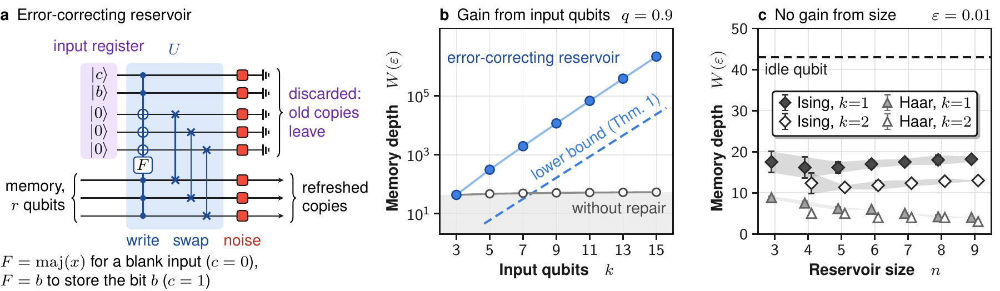

# The Fundamental Memory Ceiling of Noisy Quantum Reservoirs

**Markus Baumann, Jonas Stein, and Claudia Linnhoff-Popien · QAR-Lab, LMU Munich**

[](https://github.com/eybmits/fresh-qubits-memory/actions/workflows/ci.yml)

[Full paper + Supplemental Material](paper/memory_limits_prl_2026-10-19-concise.pdf) · [Letter](paper/submission/prl-2026-10-19-submitted/The%20Fundamental%20Memory%20Ceiling%20of%20Noisy%20Quantum%20Reservoirs.pdf) · [Reproduce the results](docs/reproduction.md) · [Cite this work](CITATION.cff) · [Releases](https://github.com/eybmits/fresh-qubits-memory/releases)

**How long can a noisy quantum system remember an input?** Under independent local depolarizing noise, after initialization washout, the optimal memory depth grows exponentially with the number of fresh input qubits supplied per step. The upper bound is independent of the total system size; an explicit error-correcting reservoir attains the exponential scaling. Noise strength and distinguishability accuracy are held fixed.

This repository contains the manuscript submitted to **Physical Review Letters on 19 October 2026**, its simulation code and datasets, figure sources, and reproducibility tools. The complete PDF has 25 pages: a six-page Letter and nineteen-page Supplemental Material.



*Figure 4 from the manuscript, with q = 0.9 and ε = 0.01. The explicit construction uses fresh qubits for repair and gains exponential memory. Within the sampled Ising and Haar ensembles, increasing system size does not extend memory. More fresh qubits raise the attainable ceiling; they do not automatically improve every reservoir.*

## Quick start: current paper

Python 3.11 or newer is required. Install the paper dependencies, including NumPy, SciPy, Matplotlib, and mpmath:

```bash
git clone https://github.com/eybmits/fresh-qubits-memory.git
cd fresh-qubits-memory
python3 -m venv .venv
source .venv/bin/activate
python -m pip install -e ".[paper]"

# Current numerical checks and numbers extracted from the supplied data.
python scripts/reproduce_paper.py check --output-dir results/local/paper-check

# Small actual Ising and Haar simulations: six seeded realizations each.
python scripts/run_prl_campaign.py --smoke --output-dir results/local/paper-smoke
```

Each command writes logs and a provenance manifest in its output directory. Choose a new directory for each run. Supplied data and manuscript files remain untouched. The smoke run covers `n=3`, `k=1`, `q=0.9`; it is a small reproduction check, not the full campaign.

## Figures and manuscript

With the [documented LaTeX tools](docs/reproduction.md#figures-and-manuscript) installed:

```bash
# Regenerate all four main figures and seven supplement figures from saved data.
python scripts/reproduce_paper.py figures --output-dir results/local/paper-figures

# Regenerate figures and compile a complete paper using those new figures.
python scripts/reproduce_paper.py build --output-dir results/local/paper-build
```

The rebuilt PDF is `results/local/paper-build/source/memory_limits_prl.pdf`. The [submitted PDF](paper/memory_limits_prl_2026-10-19-concise.pdf) is preserved separately. Figure regeneration uses the supplied numerical datasets; rerunning the simulations is a separate, more expensive step:

```bash
python scripts/run_prl_campaign.py --output-dir results/local/paper-campaign
```

The runner checks both parallel lanes and validates the expected configurations before merging results. See the [reproduction guide](docs/reproduction.md) for outputs, dependencies, checks, and the historical Table-I example.

## What is where?

| Path | Contents |
| --- | --- |
| [paper/prl-source/](paper/prl-source/) | Current manuscript, figure sources, simulator, and supplied data |
| [docs/reproduction.md](docs/reproduction.md) | Installation, commands, and expected outputs |
| [scripts/reproduce_paper.py](scripts/reproduce_paper.py) | Isolated numerical checks and figure/paper builds |
| [scripts/run_prl_campaign.py](scripts/run_prl_campaign.py) | Isolated simulation campaign with completion checks |
| [tests/](tests/) | Numerical regression and reproduction-tool tests |
| [paper/versions/](paper/versions/) | Frozen manuscript/source versions and provenance |
| [docs/repository-history.md](docs/repository-history.md) | Earlier overview and detailed validation history |

The upper and lower bounds establish the same exponential scaling class; their exponents differ. Finite simulations illustrate particular constructions and sampled reservoirs. The [manuscript verification](docs/manuscript-2026-10-19-submitted.md) and [reproduction-tool checks](docs/reproducibility-update-2026-10-19.md) identify the checks performed and their scope.

## Citation and license

Use [CITATION.cff](CITATION.cff) or the current entry in [paper/manuscript.bib](paper/manuscript.bib). The manuscript is submitted; no journal acceptance or public arXiv identifier is asserted here.

The authors' software is licensed under the [MIT License](LICENSE). Manuscripts, figures, research data, and third-party materials have separate rights; see [licensing scope](LICENSING.md).
