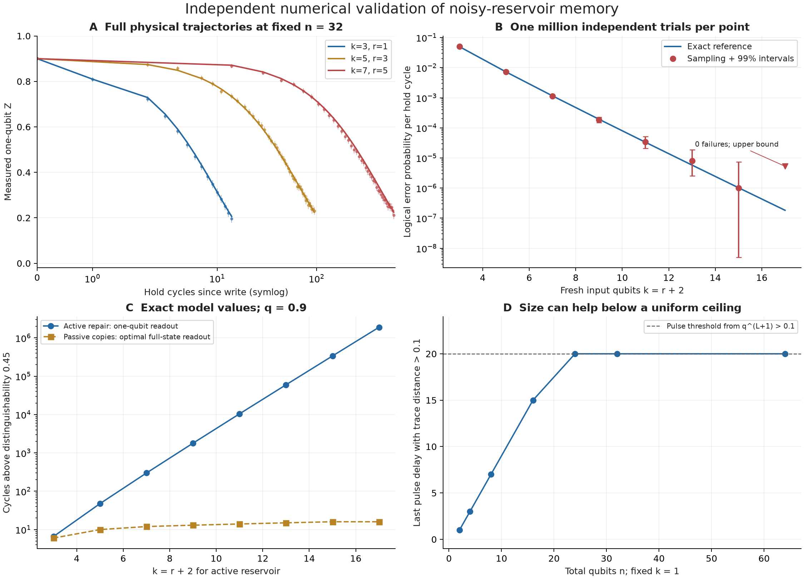
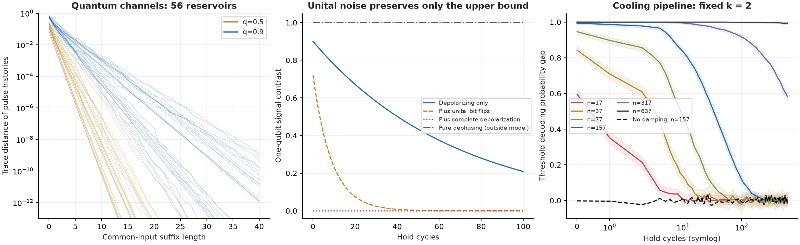

# Independent numerical validation - 16 October 2026

Scope: The Memory Limits of Noisy Quantum Reservoirs, manuscript revision 3, 16 October 2026. Base commit 77cd7a3. All cycles contain an ideal unitary followed by independent physical noise; they are not elementary gate cycles. This report records successful checks, statistical misses, and limitations.

**Assessment.** The explicit memory construction is strongly supported by independent numerical simulation within the stipulated model. No violation of the tested upper-bound ingredients was found. The experiments do not prove the universal theorem, establish asymptotic optimality, or validate a hardware implementation.

## Full channel and physical sampling

The complete reversible map was enumerated for r = 1, 3, 5, 7 (n = 4, 8, 12, 16). All four maps are permutations and agree with a separately implemented controlled-XOR-then-swap circuit. Complete diagonal probability distributions were propagated through discard, preparation, the unitary, and physical noise at q = 0.5, 0.7, 0.9, for both written bits and 30 hold cycles. Across 372 time points, the largest discrepancy from Eq. (14) was 2.10e-14. Diagonal dynamics are the exact quantum dynamics of this particular construction.

At fixed total n = 32, 12,000 explicit bit trajectories per setting reproduced the decay for k = 3, 5, 7. The formula lies in 88 of 97 pointwise 95% intervals; the largest residual is 2.53 marginal standard deviations. The nine misses are retained. Points along a trajectory are correlated, and the intervals are not a simultaneous confidence band. Independent one-step sampling used one million physical error patterns for each odd r from 1 to 15. All eight reference probabilities lie inside the exact 99% Clopper-Pearson intervals.

| k | Failures / 1,000,000 | Reference probability | Inside 99% interval |
| --- | --- | --- | --- |
| 3 | 50,184 | 0.05 | Yes |
| 5 | 7,196 | 0.00725 | Yes |
| 7 | 1,144 | 0.001158 | Yes |
| 9 | 185 | 0.0001936 | Yes |
| 11 | 34 | 3.322e-05 | Yes |
| 13 | 8 | 5.801e-06 | Yes |
| 15 | 1 | 1.026e-06 | Yes |
| 17 | 0 | 1.83e-07 | Yes |

## Rare-event follow-up

Direct sampling recorded zero majority failures at r = 15. It gives a 99% upper error-probability bound of 5.30e-6 and only a lower half-life bound of 65,412 cycles; it cannot resolve 1.89 million cycles precisely. A separately declared follow-up used importance sampling: explicit error patterns at proposal probability 1/2, reweighted to target probability 0.05. Each r uses 64 independent batches of 50,000 patterns. The approximate 99% Student-t intervals below use the variation of those batch means. These are model-based rare-event estimates, not direct million-cycle observations.

| k | Rare-event half-life estimate | Approx. 99% interval | Exact reference |
| --- | --- | --- | --- |
| 11 | 10,441 | 10,418 - 10,465 | 10,432 |
| 17 | 1,897,830 | 1,893,049 - 1,902,636 | 1,894,286 |
| 33 | 1.5574e+12 | 1.5523e+12 - 1.5626e+12 | 1.5559e+12 |

## General quantum channels and cooling

Fifty-six reservoirs with n = 2..5, k = 1 or 2 < n, q = 0.5 or 0.9, fixed Haar unitaries, and nonorthogonal input states were simulated as complex density matrices. Initialization pairs converged to trace distance below 1e-12 within at most 60 warmup steps. Differing input pulses were then followed by 40 common inputs. The largest observed purity-recursion ratio was 0.9304 (bound 1). All common-norm checks passed; for 336 independent traceless Hermitian operators the largest contraction ratio was 0.6843. Density-matrix traces stayed within 2.99e-14 of one. These selected histories do not exhaust the supremum defining memory depth.

Appendix C was implemented as an exact block-count Markov process: block rotation, XOR, and independent physical bit transitions. Correlations between all cooling blocks are retained. With q = 0.9, gamma = 0.3, s = 4, only k = 2 control qubits are reset. There are 3,000 trajectories per written bit and 600 hold cycles. The initial distribution is the exact stationary echo state for an infinite all-store-zero prefix, avoiding an initialization-purity benefit. The reported gap is P(threshold=1 | write 1) minus P(threshold=1 | write 0), a lower witness for trace distance. The intervals combine two exact 97.5% binomial intervals, yielding at least 95% pointwise coverage. None of the 17 nonvacuous analytical bound values exceeded the corresponding upper confidence endpoint.

| n | gamma | Decoding gap at 600 cycles | Pointwise 95% interval |
| --- | --- | --- | --- |
| 17 | 0.3 | -0.0003 | -0.0278 to 0.0271 |
| 37 | 0.3 | 0.0147 | -0.0244 to 0.0537 |
| 77 | 0.3 | -0.0030 | -0.0323 to 0.0264 |
| 157 | 0.3 | -0.0057 | -0.0182 to 0.0069 |
| 317 | 0.3 | 0.5833 | 0.5605 to 0.6046 |
| 637 | 0.3 | 0.9937 | 0.9881 to 0.9965 |
| 157 | 0.0 | -0.0187 | -0.0599 to 0.0226 |

At n = 317 and 637 the gap remains above 0.5 at 600 cycles; these lifetimes are right-censored. The gamma = 0 control starts from its corresponding maximally mixed echo state and carries no resolvable input information. These finite-size results support the cooling mechanism and a size benefit at fixed k. They do not determine its asymptotic exponent or validate the separate approximately 1,100-qubit numerical example.

## Two wording corrections recommended

The conclusion says that additional qubits cannot extend the memory of new inputs. Taken literally, this is too strong. A legal cyclic-shift reservoir with k = 1 and q = 0.9 has pulse trace distance q^(L+1) for L < n, and zero after overwrite. At accuracy 0.1 the last retained delay grows from 1 (n = 2) to 15 (n = 16), then saturates at 20 for n >= 24. This is a counterexample to the blanket wording, not to a size-independent universal upper bound. Suggested wording: "At fixed reset width and noise strength, increasing the reservoir size cannot make driven memory grow without bound, although particular architectures can improve below this ceiling."

The abstract says that unital noise leaves the limit unchanged, and the discussion says the theorem holds verbatim. The upper bound survives extra unital layers; a matching lower bound need not survive a prescribed layer. Complete depolarization is unital and erased all memory in the control simulation (residual <= 1.12e-16). Even additional bit flips shortened the r = 3 readout markedly. Suggested wording: "Additional unital noise does not relax the upper bound, whereas non-unital noise can provide an additional entropy sink." The existing appendix already notes that the lower construction uses identity additional layers. Maximizing over the enlarged channel class is different from fixing arbitrary extra noise.

## What remains unvalidated

No finite experiment can establish a bound for every unitary, encoding, system size, or input history. At q = 0.9 and accuracy 0.45 the stated upper bound is roughly 10^143 cycles for k = 3 and 10^504 cycles for k = 17, so absence of an upper-bound violation is weak evidence for its constants. The main theorem still needs independent proof review. No test here addresses gate compilation, noise per elementary gate, reset infidelity, hardware data, nonlinear task performance, classical hardness, novelty, or quantum advantage. Pure dephasing and time-correlated Pauli errors reproduced the expected outside-model preservation and revival controls.

## Reproduction and evidence

Reproduce with: python -m pip install -e ".[validation]"; PYTHONPATH=src python -m unittest discover -s tests -v; MPLCONFIGDIR=work/mpl-cache OPENBLAS_NUM_THREADS=1 python scripts/validate_empirical.py; python scripts/build_validation_report.py. Twelve tests passed, including independent Kraus checks, Bell-state reset, physical-noise equivalence, and a joint cooling-transition check. The original Table I baseline was regenerated and is byte-identical. Seeds, versions, source hashes, all CSV rows, and the before-run protocol are preserved. The importance-sampling follow-up is explicitly dated after the first run in the protocol. No paper text or figure was changed by this validation.

[Protocol](../../experiments/empirical-2026-10-16.md) | [Metadata](metadata.json) | [Derived checks](analysis_checks.json) | [PDF report](validation_report.pdf)
